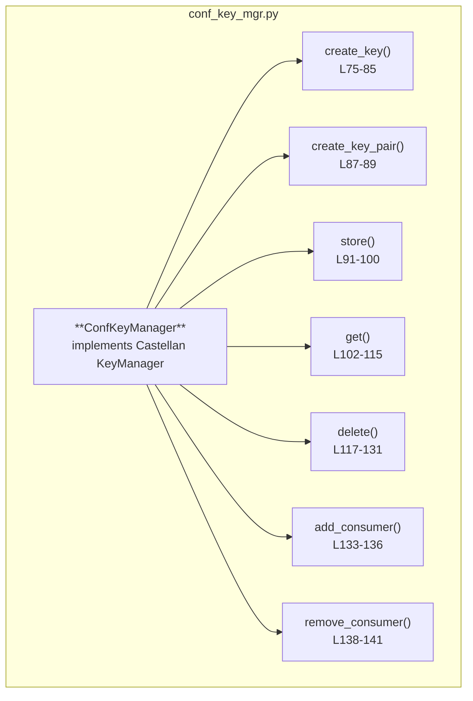

# C4 Code View — Key Manager (`keymgr`)

> Generated from C4 model (`.aee/c4-model.labelled.json`), KB records (`.aee/kb/src/nova/keymgr/`), and Component:keymgr.
> `aee-c4-render` was not available; diagram rendered directly from labelled model elements.

## Classes and Entry Points

## Symbol Descriptions

All descriptions are cited to KB records (`.aee/kb/src/nova/keymgr/conf_key_mgr.py.json`).

| Symbol | Kind | Line range | Description |
|---|---|---|---|
| `ConfKeyManager` | class | L49–L141 | Implements Castellan `KeyManager`; serves a single AES key from `nova.conf` hex value; create/store/delete raise `Forbidden` or are no-ops. (KB L49-141) |
| `ConfKeyManager.__init__` | method | L57–L69 | Initialises with configuration; decodes and validates the hex AES key from `CONF.key_manager.fixed_key`; raises `ValueError` if key is missing. (KB L57-69) |
| `ConfKeyManager._get_key` | method | L71–L73 | Returns a `castellan.SymmetricKey` from the raw hex bytes; called internally by `get`. (KB L71-73) |
| `ConfKeyManager.create_key` | method | L75–L85 | Accepts algorithm/length but always returns the fixed `key_id`; real key generation is not supported. (KB L75-85) |
| `ConfKeyManager.create_key_pair` | method | L87–L89 | Always raises `NotImplementedError`. (KB L87-89) |
| `ConfKeyManager.store` | method | L91–L100 | Raises `KeyManagerError` if the managed object is not the pre-configured key; otherwise returns `key_id`. (KB L91-100) |
| `ConfKeyManager.get` | method | L102–L115 | Returns the AES `SymmetricKey` decoded from `nova.conf`; raises `KeyError` if `managed_object_id` does not match `key_id`. (KB L102-115) |
| `ConfKeyManager.delete` | method | L117–L131 | Always raises `Forbidden`; deletion of the configuration-backed key is not permitted. (KB L117-131) |
| `ConfKeyManager.add_consumer` | method | L133–L136 | Raises `NotImplementedError`. (KB L133-136) |
| `ConfKeyManager.remove_consumer` | method | L138–L141 | Raises `NotImplementedError`. (KB L138-141) |

## File Structure

| File | Code lines | CCN (top) |
|---|---:|---:|
| `__init__.py` | 0 | — |
| `conf_key_mgr.py` | 95 | 3 (`__init__`, `store`, `get`, `delete`) |

## Cross-Component Interfaces

No cross-component edges found in link graph. No seams recorded.
A missing edge means no edge was found, never that there is no coupling.
