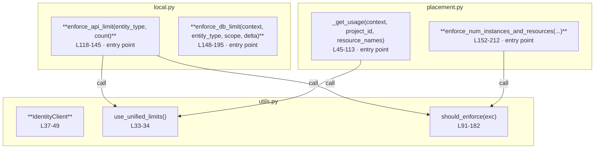

# C4 Code View — Limit Enforcement (`limit`)

> Generated from C4 model (`.aee/c4-model.labelled.json`), KB records (`.aee/kb/src/nova/limit/`), and Component:limit.
> `aee-c4-render` was not available; diagram rendered directly from labelled model elements.

## Classes and Entry Points

The `limit` component contains no inheritance chains; file-level static relationships: `local.py` → `utils.py` (3 edges: call+import) and `placement.py` → `utils.py` (3 edges: call+import). Source: Link Graph fileEdges.

## Symbol Descriptions

All descriptions cited to KB records under `.aee/kb/src/nova/limit/`.

| Symbol | Kind | File | Line range | Description |
|---|---|---|---|---|
| `IdentityClient` | class | `utils.py` | L37–L49 | Wraps an OpenStack SDK connection to query Keystone registered limits for a given service and region. (KB utils.py L37-49) |
| `IdentityClient.registered_limits` | method | `utils.py` | L47–L49 | Returns list of registered limits from Keystone for the configured service and region. (KB utils.py L47-49) |
| `use_unified_limits` | function | `utils.py` | L33–L34 | Returns `True` when the quota driver is configured as the unified Keystone limits driver. (KB utils.py L33-34) |
| `should_enforce` | function | `utils.py` | L91–L182 | Given a `ProjectOverLimit` exception, determines whether the exceeded limit should actually be enforced based on configuration. (KB utils.py L91-182) |
| `_identity_client` | function | `utils.py` | L52–L88 | Returns or lazily builds the cached `IdentityClient` singleton; not an entry point. (KB utils.py L52-88) |
| `enforce_api_limit` | function | `local.py` | L118–L145 | Checks `entity_type` count against API limits, using unified or legacy driver as configured; raises `OverQuota` on violation. (Component:limit local.py L118-145) |
| `enforce_db_limit` | function | `local.py` | L148–L195 | Enforces DB-backed quota limits for the given `entity_type`/`scope`/`delta`; delegates to `oslo_limit` Enforcer. (Component:limit local.py L148-195) |
| `_get_usage` | function | `placement.py` | L45–L113 | Retrieves current resource usage counts for a project from placement and supplemental sources; called by `oslo_limit` enforcer callback. (Component:limit placement.py L45-113) |
| `enforce_num_instances_and_resources` | function | `placement.py` | L152–L212 | Recursively enforces instance count and resource class limits against placement service usage; returns allowed `max_count`. (Component:limit placement.py L152-212) |

## File Structure

| File | Code lines | CCN (top symbol) |
|---|---:|---:|
| `__init__.py` | 0 | — |
| `local.py` | 162 | 7 (`enforce_db_limit`) |
| `placement.py` | 164 | 16 (`_get_usage`) |
| `utils.py` | 96 | 12 (`should_enforce`) |

## Cross-Component Interfaces

No cross-component edges found in link graph. No seams recorded.
A missing edge means no edge was found, never that there is no coupling.
