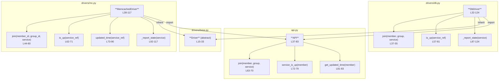

# C4 Code View — Service Group (`servicegroup`)

> Generated from C4 model (`.aee/c4-model.labelled.json`), KB records (`.aee/kb/src/nova/servicegroup/`), and Component:servicegroup.
> `aee-c4-render` was not available; diagram rendered directly from labelled model elements.

## Classes and Entry Points

File-level static relationships from Link Graph fileEdges: `__init__.py` → `api.py` (1 import), `drivers/db.py` → `api.py` (1 import), `drivers/db.py` → `drivers/base.py` (2: import+inherit), `drivers/mc.py` → `api.py` (1 import), `drivers/mc.py` → `drivers/base.py` (2: import+inherit).

## Symbol Descriptions

All descriptions cited to KB records under `.aee/kb/src/nova/servicegroup/`.

| Symbol | Kind | File | Line range | Description |
|---|---|---|---|---|
| `API` | class | `api.py` | L37–L83 | Public facade for the service group subsystem; selects and delegates to the configured driver (DbDriver or MemcachedDriver) at construction time. (Component:servicegroup api.py L37-83) |
| `API.join` | method | `api.py` | L63–L70 | Registers a service member in the named group by delegating to the active driver. (KB api.py L63-70) |
| `API.service_is_up` | method | `api.py` | L72–L79 | Returns `False` for forced-down services; otherwise delegates liveness check to the active driver. (KB api.py L72-79) |
| `API.get_updated_time` | method | `api.py` | L81–L83 | Delegates to `self._driver.updated_time(member)`. (KB api.py L81-83) |
| `Driver` | class | `drivers/base.py` | L15–L33 | Abstract base class defining the `join`/`is_up`/`updated_time` interface that all servicegroup drivers must implement. (Component:servicegroup drivers/base.py L15-33) |
| `DbDriver` | class | `drivers/db.py` | L32–L124 | Servicegroup driver that persists heartbeats to the Nova database; extends Driver. (Component:servicegroup drivers/db.py L32-124) |
| `DbDriver.join` | method | `drivers/db.py` | L37–L55 | Schedules periodic `_report_state` calls via `oslo_messaging`; starts the fixed-interval heartbeat for a service member. (KB drivers/db.py L37-55) |
| `DbDriver.is_up` | method | `drivers/db.py` | L57–L81 | Checks whether a service DB record was updated within the configured `report_interval+down_time` window. (KB drivers/db.py L57-81) |
| `DbDriver._report_state` | method | `drivers/db.py` | L87–L124 | Saves a service heartbeat to the database; handles forced-down services by raising `ServiceNotFound`. (KB drivers/db.py L87-124) |
| `MemcachedDriver` | class | `drivers/mc.py` | L38–L117 | Servicegroup driver that uses Memcached for heartbeat storage; extends Driver. (Component:servicegroup drivers/mc.py L38-117) |
| `MemcachedDriver.join` | method | `drivers/mc.py` | L44–L60 | Schedules periodic `_report_state` calls and writes an initial Memcached heartbeat entry. (KB drivers/mc.py L44-60) |
| `MemcachedDriver._report_state` | method | `drivers/mc.py` | L92–L117 | Writes a TTL-keyed heartbeat to Memcached; falls back to DB on cache miss. (KB drivers/mc.py L92-117) |

## File Structure

| File | Code lines | CCN (top symbol) |
|---|---:|---:|
| `__init__.py` | 6 | — |
| `api.py` | 47 | 2 (`API.__init__`, `API.service_is_up`) |
| `drivers/__init__.py` | 0 | — |
| `drivers/base.py` | 15 | 1 |
| `drivers/db.py` | 78 | 6 (`DbDriver._report_state`) |
| `drivers/mc.py` | 70 | 4 (`MemcachedDriver.updated_time`, `MemcachedDriver._report_state`) |

## Cross-Component Interfaces

No cross-component edges found in link graph. No seams recorded.
A missing edge means no edge was found, never that there is no coupling.
