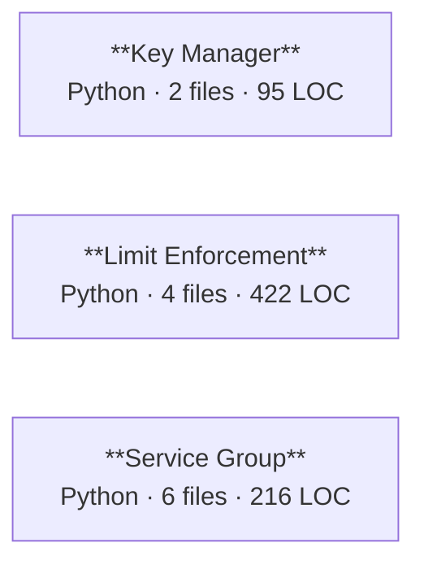

# System Architecture

> **C2 containers deferred.** Container-level architecture requires deployment inputs (Dockerfiles, Kubernetes manifests, compose files, console-script entry points) that the pipeline does not extract for this repository.
>
> **C1 actors pending.** No `.aee/c4-actors.json` has been curated; actors (people/roles) are omitted from the context view.
>
> **aee-c4-verify not run.** The `aee-c4-verify` tool is not installed in this environment; label-never-link validation was not performed automatically. The model structure is derived directly from the link-graph and KB records and contains no invented elements.

---

## System Overview

The Nova sub-system extracted in this pipeline spans three components. The **Key Manager** (`keymgr`) implements the Castellan `KeyManager` interface, serving a single AES symmetric key decoded from a hex value in `nova.conf` with all mutating operations either no-ops or access-denied. The **Limit Enforcement** (`limit`) component provides quota and resource-limit checking across three enforcement layers: API-level limits, database-backed quotas, and unified Keystone placement limits via `oslo_limit`. The **Service Group** (`servicegroup`) component provides service membership registration and liveness checking through a pluggable driver architecture shipping two concrete drivers — a database heartbeat driver and a Memcached-backed driver. No static cross-component edges were found in the link graph; the three components are independent within the extracted scope. (Sources: Component:keymgr, Component:limit, Component:servicegroup)

---

## C4 System Context (C1 — skeleton)

No actors are drawn; actors are pending a curated `.aee/c4-actors.json` input.
C2 containers are deferred (no deployment artefacts in repository).

External systems shown are those inferred from external imports by the link-graph. `nova.*` modules are part of the broader Nova codebase but were not extracted in this pipeline run (all appear as `module-not-found` in the link graph); they are shown as external systems of this pipeline scope.

```mermaid
graph TB
  subgraph nova-pipeline ["Nova Sub-system (pipeline scope)"]
    keymgr["Key Manager\n(Python)"]
    limit["Limit Enforcement\n(Python)"]
    servicegroup["Service Group\n(Python)"]
  end

  castellan["Castellan\nkey management library"]
  oslo_log["oslo.log\nlogging library"]
  oslo_limit["oslo.limit\nenforcement library"]
  openstack["OpenStack SDK"]
  os_rc["os-resource-classes\nconstants"]
  oslo_utils["oslo.utils\nutilities"]
  oslo_messaging["oslo.messaging\nRPC transport"]
  binascii["binascii\n(stdlib)"]
  typing_mod["typing\n(stdlib)"]
  functools_mod["functools\n(stdlib)"]
  datetime_mod["datetime\n(stdlib)"]
  nova_conf["nova.conf\n(out of scope)"]
  nova_core["nova core\nexception/objects\n(out of scope)"]
  nova_i18n["nova.i18n\n(out of scope)"]
  nova_sched_client["nova.scheduler.client\n(out of scope)"]
  nova_sched["nova.scheduler\n(out of scope)"]

  keymgr --> castellan
  keymgr --> oslo_log
  keymgr --> binascii
  keymgr --> nova_conf
  keymgr --> nova_core
  keymgr --> nova_i18n

  limit --> oslo_log
  limit --> oslo_limit
  limit --> openstack
  limit --> os_rc
  limit --> typing_mod
  limit --> functools_mod
  limit --> nova_conf
  limit --> nova_core
  limit --> nova_sched_client
  limit --> nova_sched

  servicegroup --> oslo_log
  servicegroup --> oslo_utils
  servicegroup --> oslo_messaging
  servicegroup --> datetime_mod
  servicegroup --> nova_conf
  servicegroup --> nova_core
  servicegroup --> nova_i18n
```

---

## Component Inventory

Source: C4 model component elements (c4-model.labelled.json).

| Component | Language(s) | File count | Code lines |
|---|---|---:|---:|
| keymgr | Python | 2 | 95 |
| limit | Python | 4 | 422 |
| servicegroup | Python | 6 | 216 |
| **Total** | | **12** | **733** |

---

## C4 Component View (C3)

The graph is built from static imports and shared literals detected by the link-graph; it may miss other forms of coupling (dynamic dispatch, message-bus calls, generated clients). Cross-component runtime coupling appears only where a seam was found — **no cross-component seams were found** in this repository; the C3 view shows static coupling only.

No cross-component file edges were found. The three components have no statically-detectable coupling to each other within the extracted scope. The diagram shows them as independent nodes.

No `securitySurface` entries were recorded for any file; `entryPoints` for all components are empty. No `http-endpoint` or other seams were found either. The inbound interface of each component is not visible at the static-analysis level for this codebase.

**Component responsibilities** (cited):

- **Key Manager** — Configuration-based AES key manager implementing the Castellan KeyManager interface. (Component:keymgr)
- **Limit Enforcement** — Quota and resource-limit enforcement covering API limits, DB-backed quotas, and unified Keystone placement limits. (Component:limit)
- **Service Group** — Service group membership and health reporting with pluggable DB and Memcached drivers. (Component:servicegroup)

---

## External Dependencies

Deduplicated table of external modules with the components that import them. Source: C4 model context elements (evidence: `Link Graph externalImports` for resolved third-party/stdlib; `Link Graph unresolved` for `nova.*` sibling modules).

| Module | Kind | Used by |
|---|---|---|
| `castellan` | third-party | keymgr |
| `oslo_log` | third-party | keymgr, limit, servicegroup |
| `oslo_limit` | third-party | limit |
| `openstack` | third-party | limit |
| `os_resource_classes` | third-party | limit |
| `oslo_utils` | third-party | servicegroup |
| `oslo_messaging` | third-party | servicegroup |
| `binascii` | stdlib | keymgr |
| `functools` | stdlib | limit |
| `typing` | stdlib | limit |
| `datetime` | stdlib | servicegroup |
| `nova.conf` | unresolved (out of scope) | keymgr, limit, servicegroup |
| `nova` (exception, objects) | unresolved (out of scope) | keymgr, limit, servicegroup |
| `nova.i18n` | unresolved (out of scope) | keymgr, servicegroup |
| `nova.scheduler.client` | unresolved (out of scope) | limit |
| `nova.scheduler` | unresolved (out of scope) | limit |
