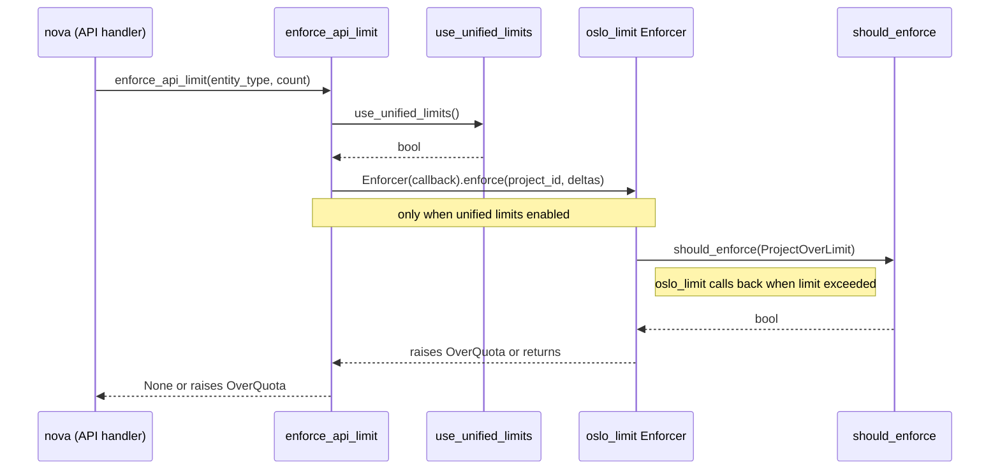
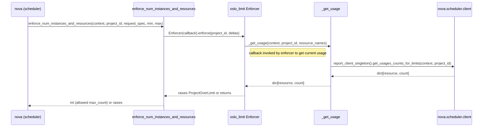
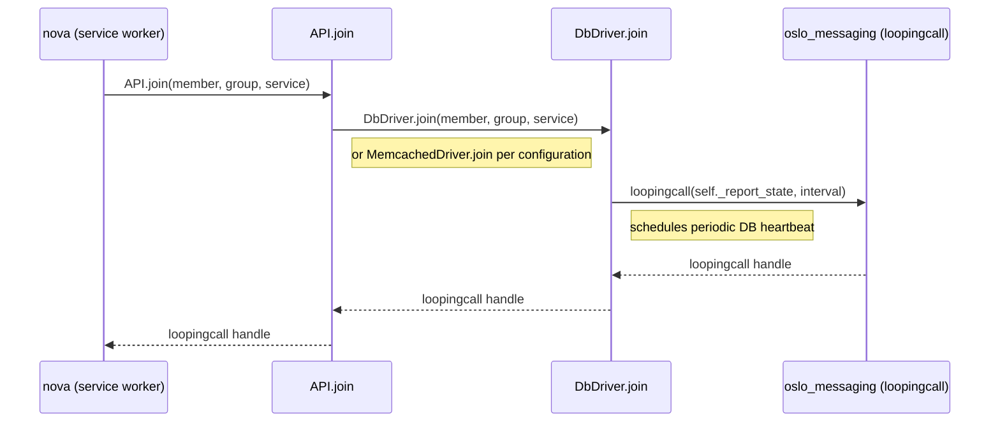
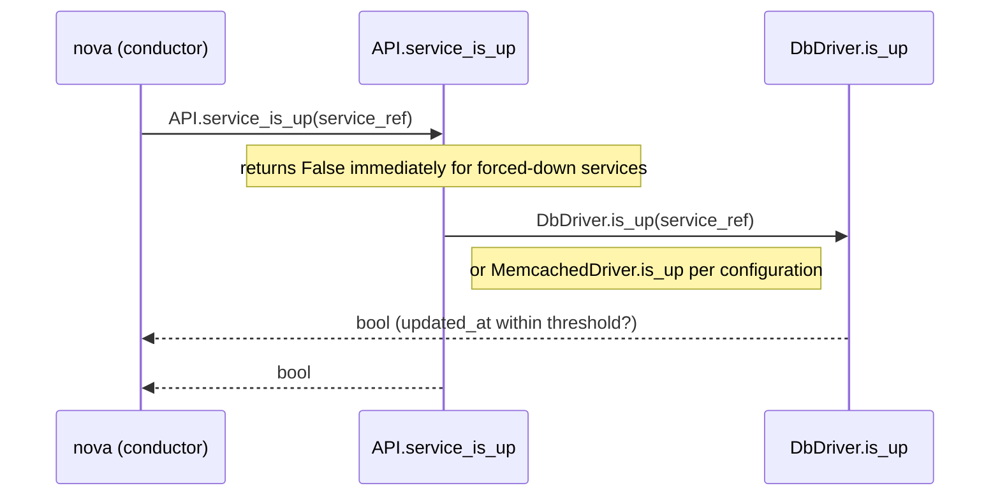

# Use-Case Sequence Diagrams

> Generated from `.aee/c4-usecases.json` and `.aee/c4-model.labelled.json`.
> `aee-c4-seq-render` was not available; diagrams rendered directly from the curated use-case definitions.
>
> **Static approximation caveat:** these scenarios show one plausible message ordering derived from static call-site analysis; they are not execution traces. Alternative paths (error branches, async callbacks, concurrent callers) are not shown. Steps are ordered by call-site line number, not by runtime scheduling.

---

## UC-1: Retrieve encryption key

**Scenario:** A Nova component requests the AES symmetric encryption key from the Key Manager via the Castellan KeyManager interface.

Participants: `nova` (broader Nova caller, out of pipeline scope), `ConfKeyManager` (keymgr), `castellan` (external library).

```mermaid
sequenceDiagram
  participant Nova as nova (caller)
  participant CKM as ConfKeyManager
  participant Cas as castellan

  Nova->>CKM: get(context, managed_object_id)
  CKM->>Cas: SymmetricKey('AES', len*8, bytes)
  Note right of CKM: decodes hex value from nova.conf; raises KeyError if id mismatch
  Cas-->>CKM: SymmetricKey
  CKM-->>Nova: SymmetricKey
```

Source: KB `conf_key_mgr.py` L102-115 (get), L71-73 (_get_key).

---

## UC-2: Enforce API quota limit

**Scenario:** A Nova API handler checks whether an action would exceed the configured API limit for an entity type. Uses the unified or legacy quota driver as configured.



Source: Component:limit `local.py` L118-145 (enforce_api_limit), KB `utils.py` L33-34 (use_unified_limits), L91-182 (should_enforce).

---

## UC-3: Enforce placement resource limits

**Scenario:** The Nova scheduler enforces instance count and resource class limits before allocating placement resources. The oslo_limit Enforcer calls back into `_get_usage` to retrieve current counts from the Placement API.



Source: Component:limit `placement.py` L152-212 (enforce_num_instances_and_resources), L45-113 (_get_usage).

---

## UC-4: Service registers with service group

**Scenario:** A Nova service worker registers itself in the service group and starts sending heartbeats to the database via the DbDriver (Memcached driver follows the same pattern via `MemcachedDriver.join`).



Source: Component:servicegroup `api.py` L63-70 (API.join), KB `drivers/db.py` L37-55 (DbDriver.join).

---

## UC-5: Check service liveness

**Scenario:** A Nova conductor queries whether a service node is considered alive based on its last heartbeat timestamp.



Source: Component:servicegroup `api.py` L72-79 (API.service_is_up), KB `drivers/db.py` L57-81 (DbDriver.is_up).
