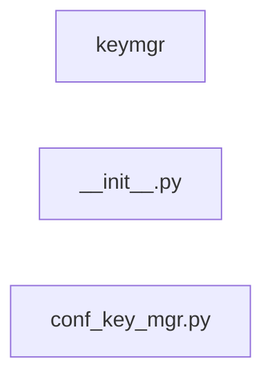

# Component: keymgr

## Overview

Configuration-based key manager that implements the Castellan `key_manager.KeyManager` interface (`conf_key_mgr.py` L49–L141, KB: `.aee/kb/src/nova/keymgr/conf_key_mgr.py.json`). Serves a single AES symmetric key decoded from a hex value in `nova.conf`; all create/store/delete operations are either no-ops or raise `Forbidden`/`NotImplementedError` to prevent misuse. 2 files (16.7% of 12 source files), 95 code lines (13.0% of 733 total). No cross-component neighbours recorded in the link graph.

## File Inventory

### (top-level)/

| File | Code Lines | Top CCN |
|---|---:|---:|
| `__init__.py` | 0 | — |
| `conf_key_mgr.py` | 95 | 3 |

**Top 5 Functions by CCN**

| Function | Kind | CCN | File | Line Range |
|---|---|---:|---|---|
| `ConfKeyManager.__init__` | method | 3 | `conf_key_mgr.py` | L57–L69 |
| `ConfKeyManager.store` | method | 3 | `conf_key_mgr.py` | L91–L100 |
| `ConfKeyManager.get` | method | 3 | `conf_key_mgr.py` | L102–L115 |
| `ConfKeyManager.delete` | method | 3 | `conf_key_mgr.py` | L117–L131 |
| `ConfKeyManager.create_key` | method | 2 | `conf_key_mgr.py` | L75–L85 |

## Defined Symbols

Total: 12 (imports not counted)

| Kind | Count |
|---|---:|
| method | 9 |
| constant | 2 |
| class | 1 |

## External Dependencies

| Package | Kind | Files Importing |
|---|---|---:|
| `binascii` | stdlib | 1 |
| `castellan` | third-party | 1 |
| `oslo_log` | third-party | 1 |

## Side Effects

None recorded. The deterministic Fact Extractor does not extract side effects, so this is not evidence that there are none.

## Component Diagram

## Call Flow

> Static call flow of resolved cross-file calls. Not a data flow: no parameters, no taint, no sanitisation.

### Summary

- Files: 2; symbols in call edges: 0
- Cross-file calls: 0 inside the component, 0 to other components, 0 from other components
- Boundary calls: none

No resolved cross-file calls touch this component.

## Cross-Component Interfaces

No cross-component file edges.

No cross-component seams recorded in the link graph.

A missing edge means no edge was found, never that there is no coupling (dynamic dispatch, calls on local variables and generated clients are not seen).
