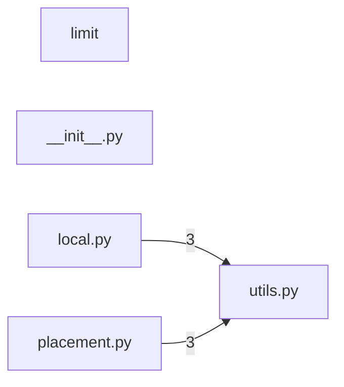
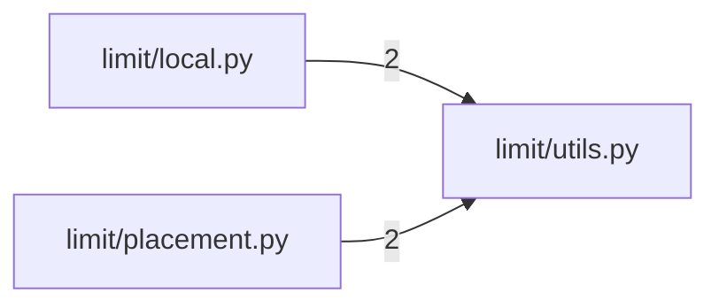
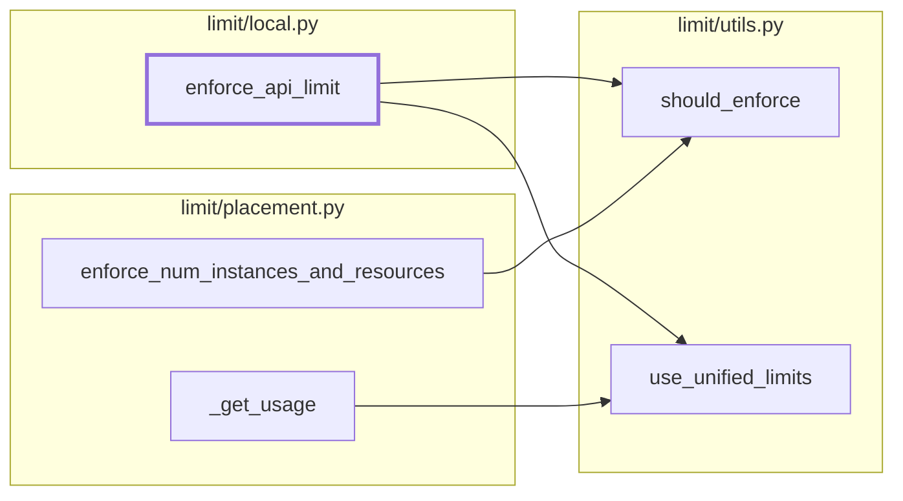
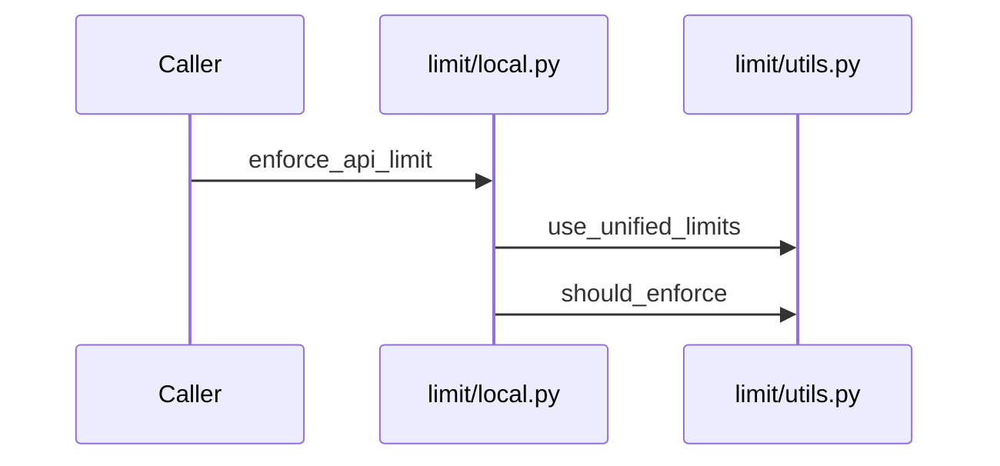

# Component: limit

## Overview

_Purpose not yet written._
4 files (33.3% of 12 source files), 422 code lines (57.6% of 733 total).

## File Inventory

### (top-level)/

| File | Code Lines | Top CCN |
|---|---:|---:|
| `__init__.py` | 0 | — |
| `local.py` | 162 | 7 |
| `placement.py` | 164 | 16 |
| `utils.py` | 96 | 12 |

**Top 5 Functions by CCN**

| Function | Kind | CCN | File | Line Range |
|---|---|---:|---|---|
| `_get_usage` | function | 16 | `placement.py` | L45–L113 |
| `should_enforce` | function | 12 | `utils.py` | L91–L182 |
| `enforce_num_instances_and_resources` | function | 10 | `placement.py` | L152–L212 |
| `_identity_client` | function | 9 | `utils.py` | L52–L88 |
| `enforce_db_limit` | function | 7 | `local.py` | L148–L195 |

## Defined Symbols

Total: 50 (imports not counted)

| Kind | Count |
|---|---:|
| constant | 22 |
| function | 22 |
| field | 3 |
| method | 2 |
| class | 1 |

## External Dependencies

| Package | Kind | Files Importing |
|---|---|---:|
| `oslo_limit` | third-party | 3 |
| `oslo_log` | third-party | 3 |
| `typing` | stdlib | 2 |
| `functools` | stdlib | 1 |
| `openstack` | third-party | 1 |
| `os_resource_classes` | third-party | 1 |

## Side Effects

None recorded. The deterministic Fact Extractor does not extract side effects, so this is not evidence that there are none.

## Component Diagram

## Call Flow

> Static call flow of resolved cross-file calls. Not a data flow: no parameters, no taint, no sanitisation.

### Summary

- Files: 4; symbols in call edges: 5
- Cross-file calls: 4 inside the component, 0 to other components, 0 from other components
- Boundary calls: none

### Entry points

Symbols no other symbol of this component calls (or that other components call).

| Entry | Reaches | Called from other components |
|---|---|---|
| limit/local.py::enforce_api_limit | 2 | 0 |
| limit/placement.py::_get_usage | 1 | 0 |
| limit/placement.py::enforce_num_instances_and_resources | 1 | 0 |

### File-level graph

Dashed border: called from another component. Dotted edge: calls into an external module.

### Symbol-level graph

Files are boxes; thick border: entry point reaching two or more symbols. Boundary calls are attributed to the file.

### Sequences

The 1 entry point(s) reaching the most symbols, depth 3, messages ordered by call-site line.

#### limit/local.py::enforce_api_limit

## Cross-Component Interfaces

No cross-component file edges.

No cross-component seams recorded in the link graph.

A missing edge means no edge was found, never that there is no coupling (dynamic dispatch, calls on local variables and generated clients are not seen).
