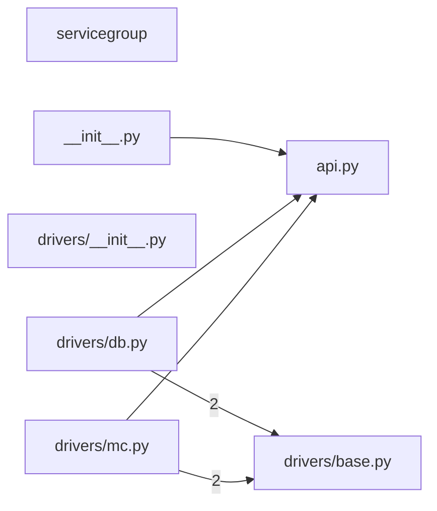

# Component: servicegroup

## Overview

_Purpose not yet written._
6 files (50.0% of 12 source files), 216 code lines (29.5% of 733 total).

## File Inventory

### (top-level)/

| File | Code Lines | Top CCN |
|---|---:|---:|
| `__init__.py` | 6 | — |
| `api.py` | 47 | 2 |

### drivers/

| File | Code Lines | Top CCN |
|---|---:|---:|
| `drivers/__init__.py` | 0 | — |
| `drivers/base.py` | 15 | 1 |
| `drivers/db.py` | 78 | 6 |
| `drivers/mc.py` | 70 | 4 |

**Top 5 Functions by CCN**

| Function | Kind | CCN | File | Line Range |
|---|---|---:|---|---|
| `DbDriver._report_state` | method | 6 | `drivers/db.py` | L87–L124 |
| `DbDriver.is_up` | method | 4 | `drivers/db.py` | L57–L81 |
| `MemcachedDriver.updated_time` | method | 4 | `drivers/mc.py` | L73–L90 |
| `MemcachedDriver._report_state` | method | 4 | `drivers/mc.py` | L92–L117 |
| `DbDriver.join` | method | 3 | `drivers/db.py` | L37–L55 |

## Defined Symbols

Total: 30 (imports not counted)

| Kind | Count |
|---|---:|
| method | 17 |
| constant | 8 |
| class | 4 |
| variable | 1 |

## External Dependencies

| Package | Kind | Files Importing |
|---|---|---:|
| `oslo_log` | third-party | 3 |
| `oslo_utils` | third-party | 3 |
| `datetime` | stdlib | 1 |
| `oslo_messaging` | third-party | 1 |

## Side Effects

None recorded. The deterministic Fact Extractor does not extract side effects, so this is not evidence that there are none.

## Component Diagram

## Call Flow

> Static call flow of resolved cross-file calls. Not a data flow: no parameters, no taint, no sanitisation.

### Summary

- Files: 6; symbols in call edges: 0
- Cross-file calls: 0 inside the component, 0 to other components, 0 from other components
- Boundary calls: none

No resolved cross-file calls touch this component.

## Cross-Component Interfaces

No cross-component file edges.

No cross-component seams recorded in the link graph.

A missing edge means no edge was found, never that there is no coupling (dynamic dispatch, calls on local variables and generated clients are not seen).
